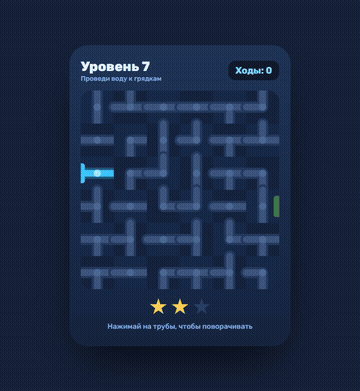
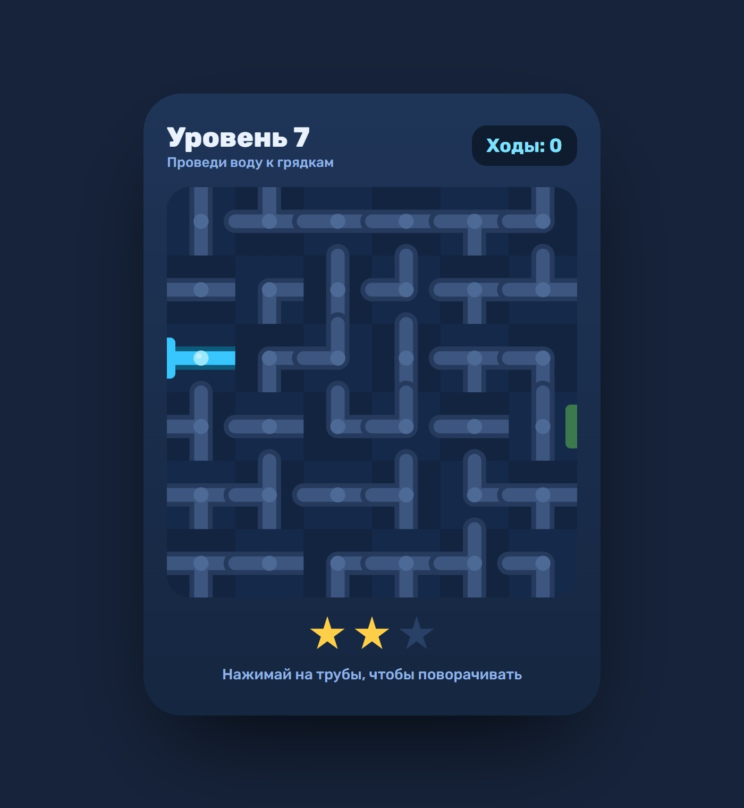
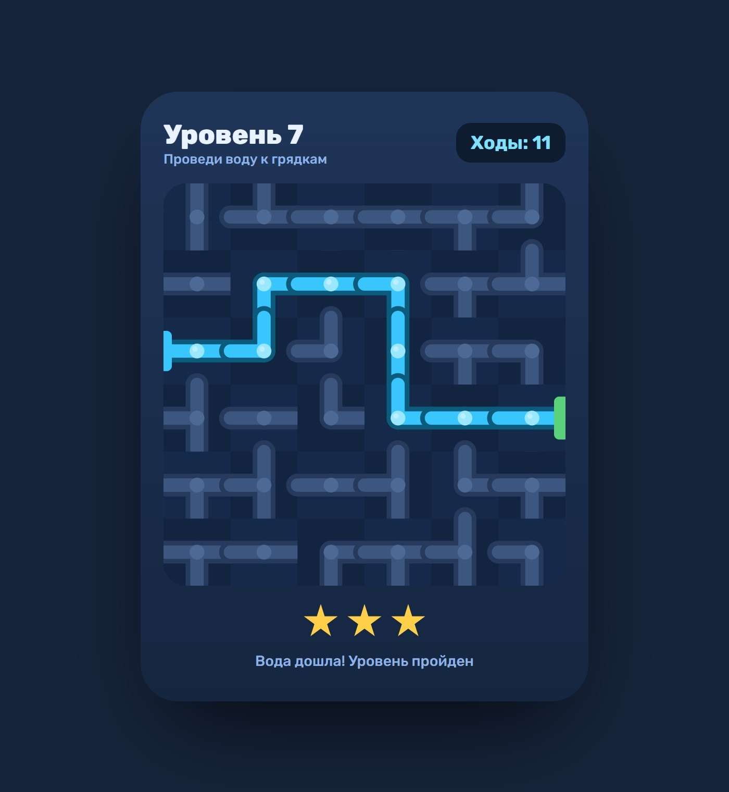

# html5-pipe-puzzle

A pipe-rotation puzzle in vanilla JavaScript and Canvas 2D, made for a promo landing and a Telegram Mini App.

- level generator with a guaranteed solvable path and seeded randomness (`?seed=`)
- flood fill runs on every move to light up connected pipes
- retina-sharp canvas, touch-friendly, works inside Telegram WebView
- deterministic `renderAt(t)` hook for recording gameplay videos
- about 100 lines, no dependencies, no build step

| | |
|---|---|
|  |  |

Open `index.html` in a browser.
